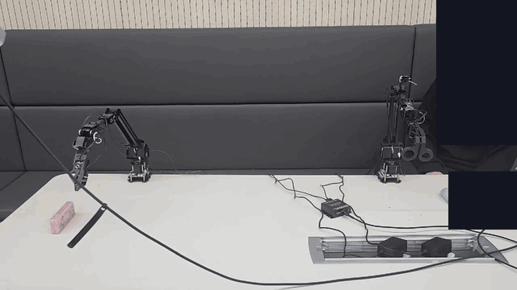
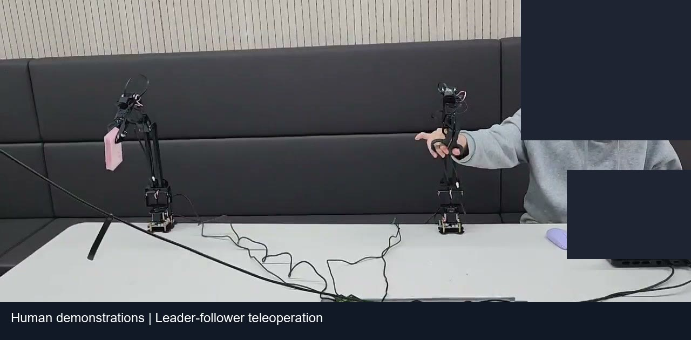
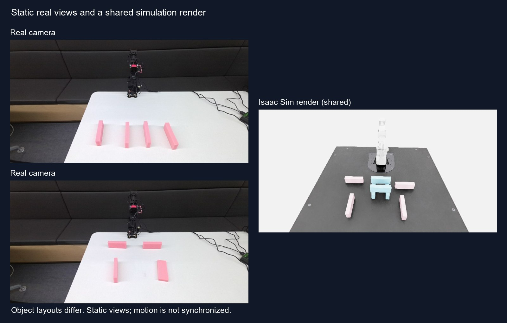

# RoArm Robotics Portfolio

I collect robot demonstrations, calibrate cameras, and inspect robot behavior on hardware and in simulation.

*Fine-tuned SmolVLA on a real arm. Success rate not measured.*

[Watch the demo](https://youtu.be/Ci7bw9PL_RI) — Selected projects; edited excerpts.

[LinkedIn](https://www.linkedin.com/in/jaehyeon-park-763284305)

## Demonstrations to a real-arm policy

*Human demonstrations collected by leader-follower teleoperation.*

Early demonstrations rarely reached deep grasp poses, and a later collection omitted the movement from the starting pose. I inspected joint distributions, revised the collection criteria, and added a start-pose check to the Python recorder. Using Azure Kinect RGB and leader-follower teleoperation, I collected demonstrations, converted them to LeRobot format, and fine-tuned SmolVLA, a vision-language-action model, with PyTorch.

The final dataset contains 50 episodes and 6,942 frames, with a dataset sampling rate of 30 fps; all episodes are training data. The policy clip shows a real arm grasping and lifting a sponge. This work highlighted the need to check pose coverage and the initial movement when collecting demonstrations.

[Collection and policy workflow](projects/data-to-policy/README.md)

## Camera calibration and joint replay

*Static real views with a shared simulation render; object layouts differ.*

Replaying real-arm recordings required separate checks of the camera transform, table plane, and joint tracking. I used Azure Kinect, calibration markers, and Python to estimate the camera-to-robot transform and table plane, then built an Isaac Sim twin from the URDF and camera viewpoint. I compared recorded joint targets with the simulated joints during replay.

The marker-based calibration RMSE was 10.13 mm using 27 of 31 poses, rated **MARGINAL**, acceptable for the simulation pipeline. Simulation replay yielded a mean per-episode joint RMSE of 0.43° across 45 episodes and 6,331 frames, measured between target and simulated joint angles. These checks separate calibration residuals, visual differences, and joint replay error.

[Calibration and replay workflow](projects/calibration-and-twin/README.md)

## Diagnosing a policy's release failure

*Recorded trajectory replay in Isaac Sim; render rotation adjusted.*

An Isaac Lab PPO policy grasped the object but remained near the target with the jaws closed. I compared training metrics with recorded trajectories and classified the failure behavior.

The replay shows the object still held when the task requires release; the rotation adjustment affects the displayed render. The analysis highlighted the need to inspect the reward, stage-completion checks, and observed action separately.

[Policy failure analysis](projects/policy-failure-analysis/README.md)

## Research code and discussion

Research code remains private. I can discuss the collection workflow, calibration procedure, and failure analysis in an interview.

For content reuse, see [LICENSE.md](LICENSE.md).
