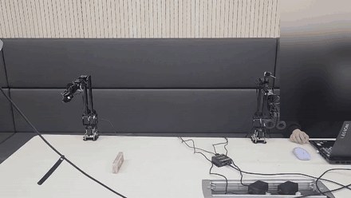
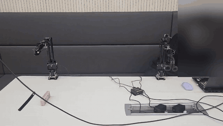
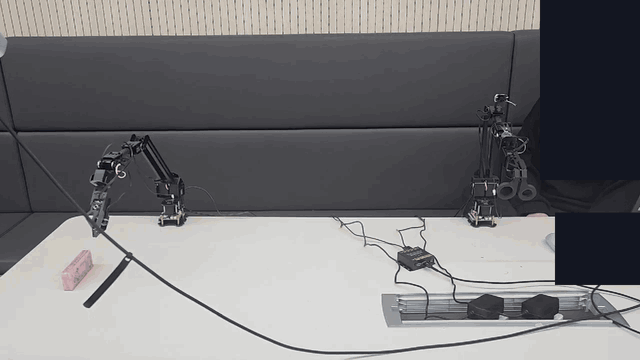
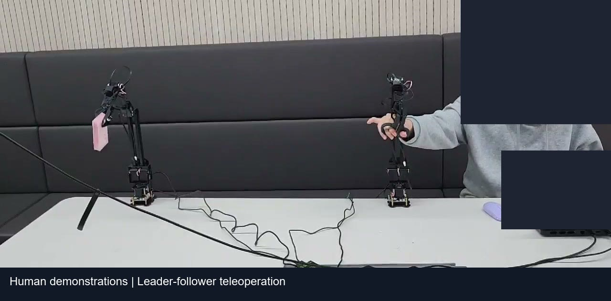
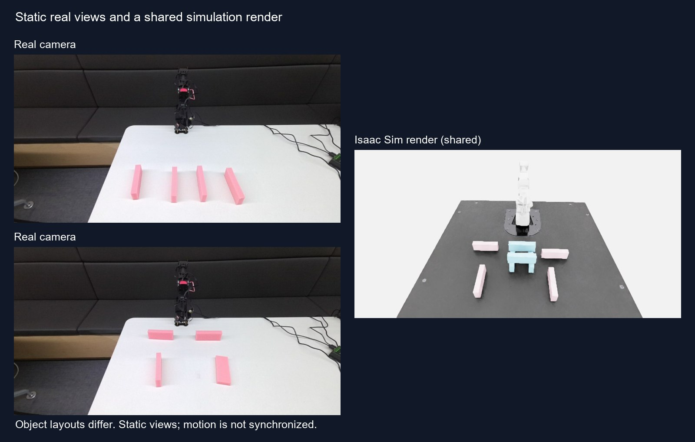
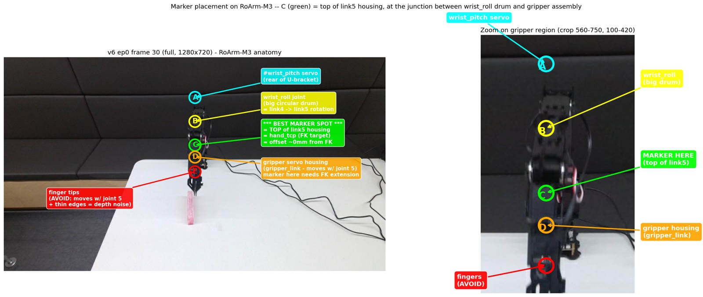
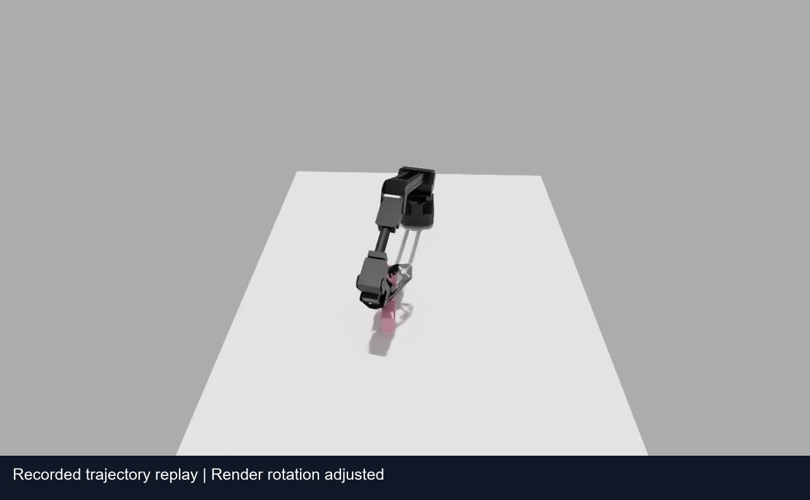
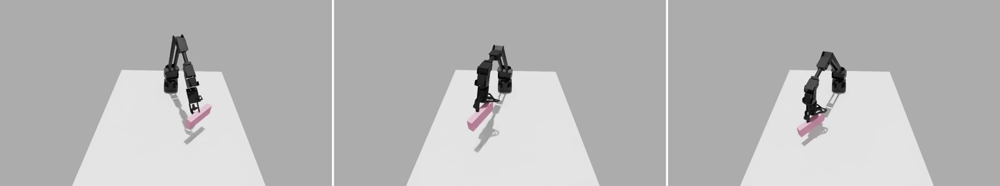

# RoArm Robotics Portfolio

I collect robot demonstrations, calibrate cameras, and inspect robot behavior on hardware and in simulation.

| | |
|---|---|
| [](media/videos/sponge-pick-20260414-a.mp4) | [](media/videos/sponge-pick-20260414-b.mp4) |

*Fine-tuned SmolVLA policy running on a real RoArm-M3 and grasping a sponge, two runs recorded on 2026-04-14 (previews at 1.5x speed; click for the full video). The person's face is blurred.*



*Fine-tuned SmolVLA on a real arm. Success rate not measured.*

[Watch the demo](https://youtu.be/Ci7bw9PL_RI) — Selected projects; edited excerpts.

[LinkedIn](https://www.linkedin.com/in/jaehyeon-park-763284305)

## Demonstrations to a real-arm policy



*Human demonstrations collected by leader-follower teleoperation.*

Early demonstrations rarely reached deep grasp poses, and a later collection omitted the movement from the starting pose. I inspected joint distributions, revised the collection criteria, and added a start-pose check to the Python recorder. Using Azure Kinect RGB and leader-follower teleoperation, I collected demonstrations, converted them to LeRobot format, and fine-tuned SmolVLA, a vision-language-action model, with PyTorch.

The final dataset contains 50 episodes and 6,942 frames, with a dataset sampling rate of 30 fps; all episodes are training data. The policy clip shows a real arm grasping and lifting a sponge. This work highlighted the need to check pose coverage and the initial movement when collecting demonstrations.

[Collection and policy workflow](projects/data-to-policy/README.md)

## Camera calibration and joint replay



*Static real views with a shared simulation render; object layouts differ.*

Replaying real-arm recordings required separate checks of the camera transform, table plane, and joint tracking. I used Azure Kinect, calibration markers, and Python to estimate the camera-to-robot transform and table plane, then built an Isaac Sim twin from the URDF and camera viewpoint. I compared recorded joint targets with the simulated joints during replay.



*Candidate marker spots on the wrist, annotated on a recorded camera frame.*

The marker-based calibration RMSE was 10.13 mm using 27 of 31 poses, rated **MARGINAL**, acceptable for the simulation pipeline. Simulation replay yielded a mean per-episode joint RMSE of 0.43° across 45 episodes and 6,331 frames, measured between target and simulated joint angles. These checks separate calibration residuals, visual differences, and joint replay error.

[Calibration and replay workflow](projects/calibration-and-twin/README.md)

## Diagnosing a policy's release failure



*Recorded trajectory replay in Isaac Sim; render rotation adjusted.*

An Isaac Lab PPO policy grasped the object but remained near the target with the jaws closed. I compared training metrics with recorded trajectories and classified the failure behavior.



*Isaac Lab frames from release-stage PPO policies: the sponge stays in the gripper.*

The replay shows the object still held when the task requires release; the rotation adjustment affects the displayed render. The analysis highlighted the need to inspect the reward, stage-completion checks, and observed action separately.

[Policy failure analysis](projects/policy-failure-analysis/README.md)

## Code

`src/roarm_tools` holds the offline parts of the calibration and data-collection work, with small samples taken from the original recordings in `examples/data`. No robot, camera, or simulator is needed to run them.

```
python -m venv .venv && .venv/Scripts/activate   # source .venv/bin/activate on Linux/macOS
pip install -e .[test]
python -m roarm_tools.handeye examples/data/handeye_captures.json
```

| Command | What it does | Sample input |
|---|---|---|
| `python -m roarm_tools.handeye examples/data/handeye_captures.json` | Camera-to-robot calibration from wrist-marker observations; prints the RMSE and rejected poses | 31 marker captures |
| `python -m roarm_tools.replay examples/data/replay_tracking.csv` | Joint RMSE between recorded joint targets and simulated joints | 50 episodes, 6,942 frames |
| `python -m roarm_tools.episodes examples/data/replay_tracking.csv --plot joints.png` | Start-pose and save checks from the recorder, and the joint distribution of the dataset | same file |
| `python -m roarm_tools.table_plane <recordings> --calib <calib.yaml>` | Table plane from depth frames; needs `pip install -e .[table]` and Kinect recordings (not included) | none |
| `pytest` | Checks the solvers on synthetic data and the sample outputs against the numbers above | |

Not included: the hardware recorder, the marker capture script, the Isaac Sim replay and the PPO environment. They need a RoArm-M3 leader-follower pair, an Azure Kinect, or Isaac Sim and Isaac Lab, and stay in the private repository. The project pages describe what each produced.

Code written with Claude Code and Codex, reviewed and tested by the author.

## Licenses

- Code (`src/`, `tests/`, `pyproject.toml`) is under the MIT license in [LICENSE](LICENSE).
- Writing, diagrams, photos, videos, and the sample data in `examples/data` are covered by [LICENSE.md](LICENSE.md); no reuse license is granted for them.
