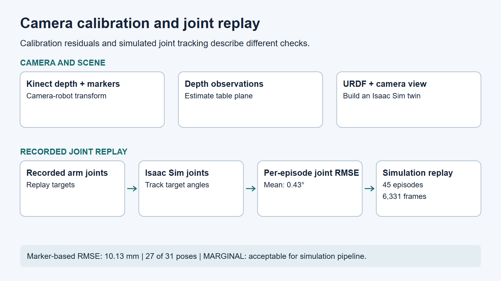

# Camera calibration and joint replay

## Problem

Replaying real-arm recordings required separate checks of the camera transform, table plane, and joint tracking.

## My work

I used Azure Kinect, calibration markers, and Python to estimate the camera-to-robot transform and table plane, then built an Isaac Sim twin from the URDF and camera viewpoint. I compared recorded joint targets with the simulated joints during replay.

## Tools and sensors

Azure Kinect, calibration markers, Python, URDF, and Isaac Sim.

## Results

The marker-based calibration RMSE was 10.13 mm using 27 of 31 poses, rated **MARGINAL**, acceptable for the simulation pipeline. Simulation replay yielded a mean per-episode joint RMSE of 0.43° across 45 episodes and 6,331 frames, measured between target and simulated joint angles.

I kept camera calibration, table fitting, and simulated joint tracking as separate checks. For replay, joint RMSE was computed at each frame, averaged within each episode, then averaged across 45 episodes. The summary excludes five episodes from the aggregate. This is simulated joint tracking error, not a measurement of real-arm positioning accuracy.

*Static real views with a shared simulation render; object layouts differ. Motion is not synchronized.*

## What I learned

These checks separate calibration residuals, visual differences, and joint replay error.

[Portfolio](../../README.md)
