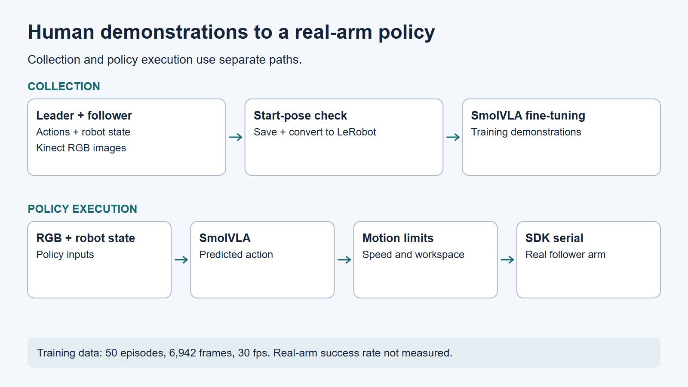
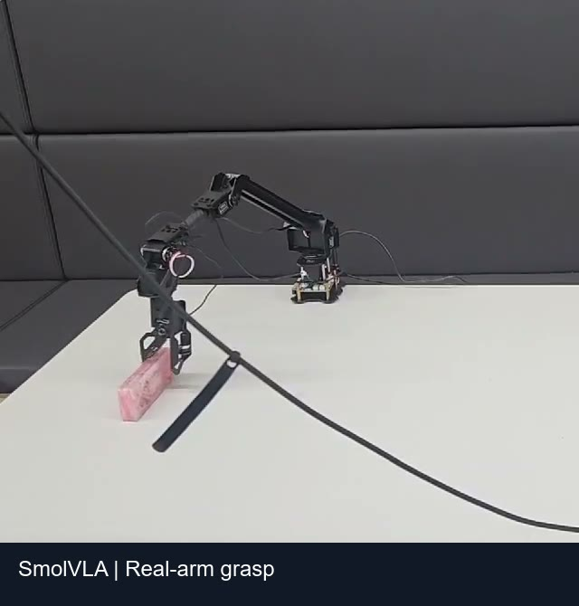
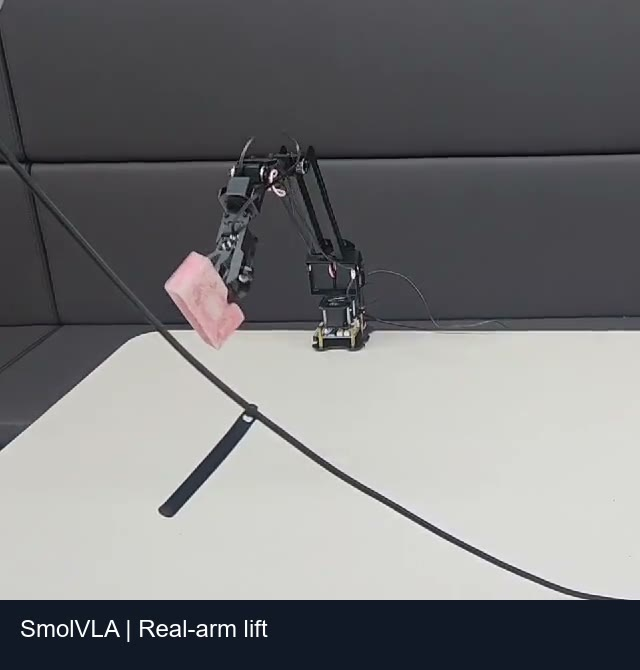
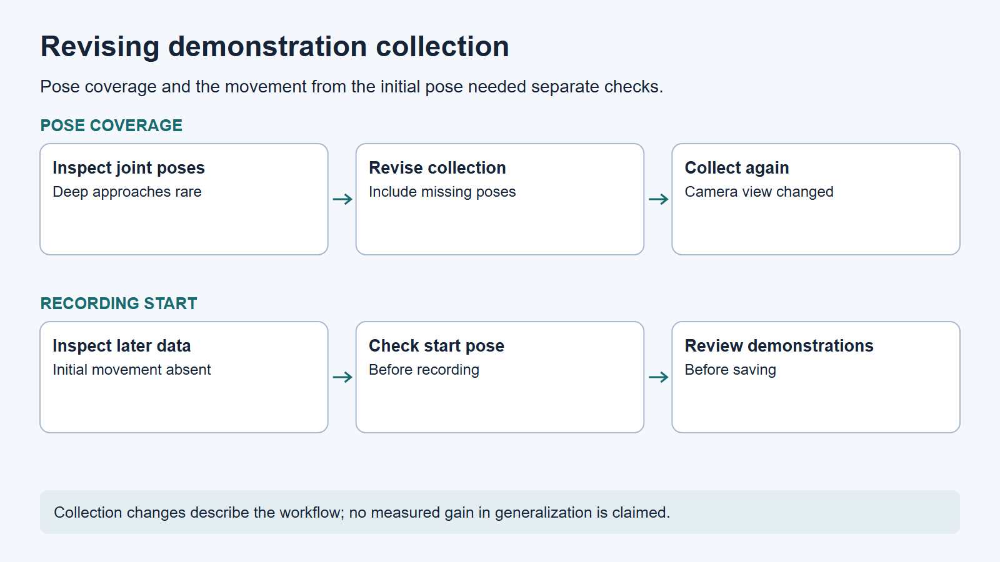

# Demonstrations to a real-arm policy

## Problem

Early demonstrations rarely reached deep grasp poses, and a later collection omitted the movement from the starting pose.

## My work

I inspected joint distributions, revised the collection criteria, and added a start-pose check to the Python recorder. Pose coverage and the recording-start pose needed separate checks. The recorder checks the initial joint pose before starting a new recording and flags episode-quality issues before saving. An operator can override a failed save check. I converted the recorded demonstrations to LeRobot format and fine-tuned SmolVLA with PyTorch.

## Tools and sensors

Python, Azure Kinect RGB, leader-follower arms, LeRobot, PyTorch, and SmolVLA.

Human demonstrations were collected by leader-follower teleoperation. The recorder pairs leader-joint actions with follower-joint states and Kinect RGB images.

## Results

The final dataset contains 50 episodes and 6,942 frames, with a dataset sampling rate of 30 fps; all episodes are training data. The policy clip shows a real arm grasping and lifting a sponge. Success rate not measured.

*Selected frame from the real-arm SmolVLA clip: grasping the sponge. Success rate not measured.*

*Selected frame from the same clip: lifting the sponge. These frames do not constitute a success-rate evaluation.*

## What I learned

This work highlighted the need to check pose coverage and the initial movement when collecting demonstrations.

[Portfolio](../../README.md)
