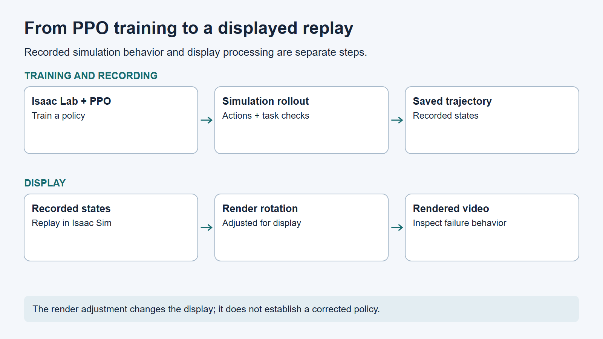
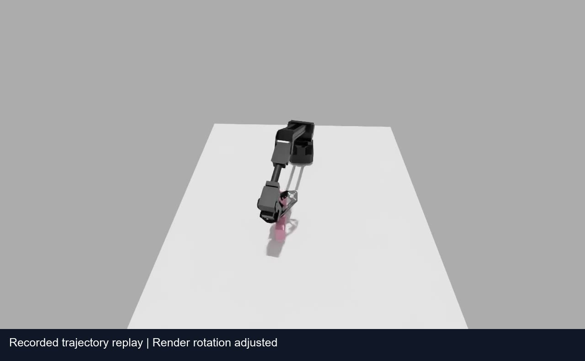
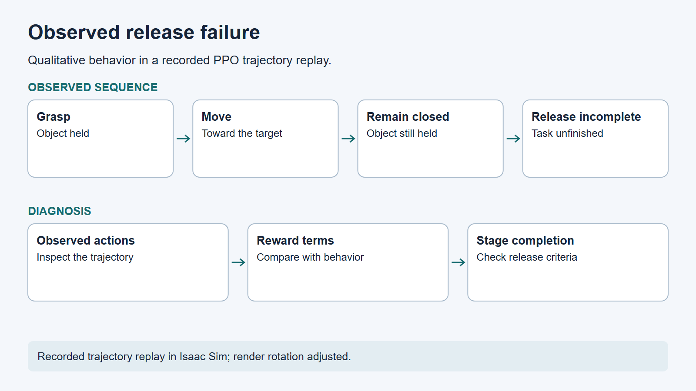

# Diagnosing a policy's release failure

## Problem

An Isaac Lab PPO policy grasped the object but remained near the target with the jaws closed.

## My work

I compared the recorded object and end-effector positions with the target, alongside jaw state and training stage checks. In the inspected replay, the object remained held near the target instead of being released. Sponge orientation is adjusted in the displayed replay; this does not establish a corrected policy.

*Recorded simulation states are replayed for inspection.*

## Tools and sensors

Isaac Lab, PPO, and Isaac Sim trajectory replay.

*Recorded trajectory replay in Isaac Sim; render rotation adjusted.*

## Results

The replay shows the object still held when the task requires release; the rotation adjustment affects the displayed render.

## What I learned

The analysis highlighted the need to inspect the reward, stage-completion checks, and observed action separately.

[Portfolio](../../README.md)
